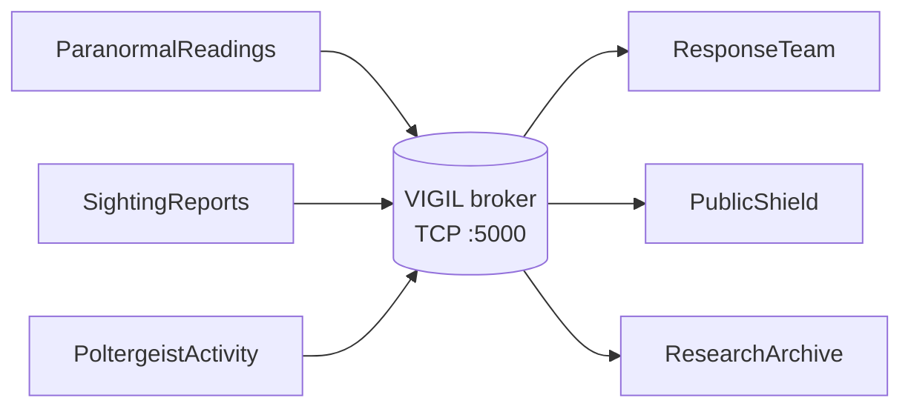

# VIGIL

> A publish/subscribe event bus for a Paranormal Affairs Office.
> Sightings, poltergeist complaints and ambient readings reach the teams that need them — and nothing is lost when a subscriber goes dark.

**CCS 231 · Distributed Systems · Option 2 · Python, standard library only**

---

## Status

Skeleton only. The tree below is the plan; the only committed files today are this README, the empty dependency list, and placeholder directories. The broker and clients land at M3, the fault matrix at M4, and the packaging at M5.

## What it does

Three publishers feed one broker. The broker appends every event to disk **before** delivering it, then routes it by topic. Subscribers see only their topics. A subscriber that disconnects is replayed exactly what it missed, in order, from its last acknowledged event.

| Publisher | Sends | Subscribers who receive it |
|---|---|---|
| `ParanormalReadings` | `readings` | ResearchArchive |
| `SightingReports` | `sighting`, and `alert` at severity ≥ 4 | ResponseTeam, PublicShield, ResearchArchive |
| `PoltergeistActivity` | `poltergeist`, and `alert` at severity ≥ 4 | ResponseTeam, PublicShield, ResearchArchive |

The `alert` line is stamped by the **publisher**, not derived by the broker. The broker routes on the topic string alone and never parses a payload — which is the topic-based filtering the assignment asks us to justify.

## Architecture



The full plate — process boundary, both JSON files, lock names, replay lane — is in [`docs/figures/architecture.png`](docs/figures/architecture.png).

## Run it

```bash
python3 --version                  # 3.11 or newer

python3 src/broker.py
python3 src/subscriber.py --as ResponseTeam  --topics sighting,poltergeist
python3 src/subscriber.py --as PublicShield  --topics alert
python3 src/publisher.py  --as SightingReports
```

Four terminals, one process each. The demo sequence and expected output are in the System Design Document.

## Repository layout

```text
.
├── README.md
├── requirements.txt        # stdlib only — deliberately declares nothing
├── .gitignore
├── docs/
│   ├── sdd.pdf             # exported from our Google Doc at packaging
│   ├── fault-test-report.md
│   └── figures/
│       └── architecture.png
├── src/
│   ├── common/             # the shared contract
│   ├── broker.py
│   ├── publisher.py
│   ├── subscriber.py
│   └── tools/
│       └── fault_inject.py
├── tests/
├── scripts/
└── data/                   # runtime only, never committed
```

Why it looks like this:

- **`src/common/` is the only shared code.** `protocol.py` (format and parse), `ids.py`, `storage.py` (atomic writes), `constants.py`, `log.py`. Everything else imports it; it imports nothing of ours. That one-way arrow is what lets five people work without stepping on each other.
- **One owner per file.** `broker.py` belongs to the server engineer, `subscriber.py` to the client engineer, `common/` to the protocol engineer. Two people never edit the same file in the same week, so every diff has an obvious reviewer.
- **Folders appear with their first file.** Git cannot commit an empty directory, so a pre-built tree just means a scattering of `.gitkeep`. `src/` exists now because the layout was agreed; `tests/` and `scripts/` arrive with the first test and the first demo run.
- **`data/` is never committed.** The event log is runtime state. A committed log would make every demo start from someone else's events.

## Dependencies

None.

`requirements.txt` is deliberately empty — the project runs on the Python standard library. No Flask, no requests, no SQLite, no message broker library: the sockets, the log and the replay are the assignment. If a PR ever adds a line to that file, the PR has to say why in one line, and that line is the part of the review that gets argued about.

## How we work

**Branches.** `feat/…`, `fix/…`, `docs/…`. One issue per branch. `main` is protected — no direct pushes, no force pushes, no merging your own pull request.

**Commits.** Atomic and conventional:

```text
feat(broker): replay missed events on SUB
fix(storage): offset prune shifted indices past min lock
test(protocol): reject oversized pipe-delimited line
```

`type(scope): subject` — imperative, ≤ 72 characters, no trailing period. Types: `feat` `fix` `docs` `test` `refactor` `chore`. Scopes: `broker` `storage` `protocol` `replay` `client` `docs` `test`. The body explains *why*; the footer carries `Refs #12`.

**Atomic** means one logical change per commit, with its test in the same commit. Never "broker + tests + report" in one go, and never a 400-line `initial commit` with half the system in it.

**Review.** Every PR gets one approving review from someone who did not write it. Reviewers read the import list first — a single `import flask` or `import requests` fails the stack rule in five seconds. The verdict goes in the PR as a comment: contract pass, stack pass, logic pass, evidence pass.

**Everyone commits as themselves.** Personal `user.name` and `user.email`, never a shared group identity. The authorship history is the provenance of the work.

## Documentation

| Document | Where |
|---|---|
| System Design Document | Google Docs (source), `docs/sdd.pdf` at packaging |
| Fault Test Report | `docs/fault-test-report.md`, filled as each case runs |
| Architecture figure | `docs/figures/architecture.png` |

## Team

Five people, five modules, one document section each. Every member writes code and can explain a module they did not write.

| Role | Owns |
|---|---|
| Systems architect | architecture, packaging, the document, review |
| Protocol engineer | `src/common/`, protocol round-trip tests |
| Server engineer | `src/broker.py`, storage, replay |
| Client engineer | `src/publisher.py`, `src/subscriber.py` |
| Test engineer | `src/tools/fault_inject.py`, fault report, integration runs |
