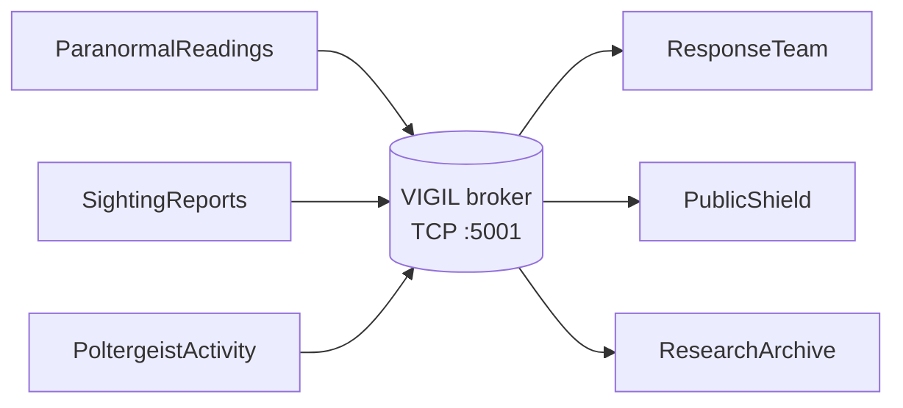

# VIGIL

> A publish/subscribe event bus for a Paranormal Affairs Office.
> Sightings, poltergeist complaints and ambient readings reach the teams that need them — and nothing is lost when a subscriber goes dark.

**CCS 231 · Distributed Systems · Option 2 · Python, standard library only**

---

## Status

The graded pub/sub backend is complete. Graded output stays line-oriented and plain — no banners, panels or colour gates. An optional seven-window demo wall was added afterwards as tooling; it lives in `src/tools/tui.py` and is never imported by the broker, clients or tests.

## What it does

Three publishers feed one broker. The broker appends every event to disk **before** delivering it, then routes it by topic. Subscribers see only their topics. A subscriber that disconnects is replayed exactly what it missed, in order, from its last acknowledged event.

| Publisher | Sends | Subscribers who receive it |
|---|---|---|
| `ParanormalReadings` | `readings` | ResearchArchive |
| `SightingReports` | `sighting`, and `alert` at severity ≥ 4 | ResponseTeam, PublicShield, ResearchArchive |
| `PoltergeistActivity` | `poltergeist`, and `alert` at severity ≥ 4 | ResponseTeam, PublicShield, ResearchArchive |

The `alert` line is stamped by the **publisher**, not derived by the broker. The broker routes on the topic string alone and never parses a payload — which is the topic-based filtering the assignment asks us to justify.

## Architecture



The full plate — process boundary, both JSON files, lock names, replay lane — is in [`docs/figures/architecture.png`](docs/figures/architecture.png).

## Run it

```bash
python3 --version                  # 3.11 or newer

python3 src/broker.py
python3 src/subscriber.py --as ResponseTeam
python3 src/subscriber.py --as PublicShield
python3 src/subscriber.py --as ResearchArchive
python3 src/publisher.py  --as SightingReports
```

Subscribers select their topics by role with `--as <Role>`; there is no `--topics` flag. Both client programs accept `--host <broker-ip>` when the broker runs on another machine. One process per terminal. The demo sequence and expected output are in the System Design Document.

## Optional demo wall

Post-M5 tooling — not part of grading, and never imported by graded code.

Close any running demo windows first. On the machine that hosts the broker, run the host launcher — it starts the broker pane, backs up `src/common/data`, and broadcasts its address on the LAN:

- **macOS:** `bash demos/mac-host.command`
- **Windows:** double-click `demos/windows-host.bat`

On other machines on the same network, run the client launcher. It discovers the broker automatically through `src/tools/discovery.py`; if no beacon is seen it falls back to `VIGIL_BROKER_HOST` and then prompts once:

- **macOS:** `bash demos/mac-client.command`
- **Windows:** double-click `demos/windows-client.bat`

The host runs seven panes; clients run six (no broker pane). Each pane owns its real child process. Ctrl+C stops only that role; Enter respawns it. The host launcher refuses to start if a broker is already running locally and backs up `src/common/data` with a timestamp (`${TMPDIR}` on macOS, `%TEMP%` on Windows). Clients keep no local log.

The broker listens on `0.0.0.0:5001` so LAN clients can reach it; port 5001 avoids the macOS AirPlay conflict on 5000. Allow Python inbound on 5001 and UDP 5002 on the host machine. There is no authentication or encryption — anyone on that network can publish or subscribe, so use an isolated LAN or hotspot.

The broker pane needs at least 120 columns (231×13 target); node panes are sized for 75×21. Column count depends on Terminal font size, so rehearse on the projector.

A single pane can also be run on its own:

```bash
python3 src/tools/tui.py --role broker
python3 src/tools/tui.py --role ResponseTeam
python3 src/tools/tui.py --role SightingReports
```

Add `--once --plain --width N --height N` for a static frame with no child — handy for checking a window size. `demos/mac-demo.command`, `demos/windows-demo.bat` and `demos/windows-demo.ps1` remain the plain-CLI fallback.

## Repository layout

```text
.
├── README.md
├── requirements.txt        # stdlib only — deliberately declares nothing
├── .gitignore
├── docs/
│   ├── sdd.pdf             # exported from our Google Doc at packaging
│   ├── fault-test-report.md
│   └── figures/
│       └── architecture.png
├── demos/
│   ├── mac-host.command    # host launcher (macOS)
│   ├── mac-client.command  # client launcher (macOS)
│   ├── mac-wall.command    # shared wall implementation
│   ├── windows-host.bat    # host launcher (Windows)
│   ├── windows-client.bat  # client launcher (Windows)
│   ├── windows-wall.bat
│   ├── windows-wall.ps1
│   ├── mac-demo.command
│   └── windows-demo.*      # plain-CLI fallback
├── src/
│   ├── common/             # the shared contract
│   ├── broker.py
│   ├── publisher.py
│   ├── subscriber.py
│   └── tools/
│       ├── tui.py          # optional demo wall, never imported by graded code
│       ├── discovery.py    # LAN broker beacon / discovery
│       └── fault_inject.py
├── tests/
├── scripts/
└── src/common/data/        # runtime only, never committed
```

Why it looks like this:

- **`src/common/` is the only shared code.** `protocol.py` (format and parse), `ids.py`, `storage.py` (atomic writes), `constants.py`, `log.py`. Everything else imports it; it imports nothing of ours. That one-way arrow is what lets five people work without stepping on each other.
- **One owner per file.** `broker.py` belongs to the server engineer, `subscriber.py` to the client engineer, `common/` to the protocol engineer. Two people never edit the same file in the same week, so every diff has an obvious reviewer.
- **Folders appear with their first file.** Git cannot commit an empty directory, so a pre-built tree just means a scattering of `.gitkeep`. `src/` exists now because the layout was agreed; `tests/` and `scripts/` arrive with the first test and the first demo run.
- **`data/` is never committed.** The event log is runtime state. A committed log would make every demo start from someone else's events.

## Dependencies

None.

`requirements.txt` is deliberately empty — the project runs on the Python standard library. No Flask, no requests, no SQLite, no message broker library: the sockets, the log and the replay are the assignment. If a PR ever adds a line to that file, the PR has to say why in one line, and that line is the part of the review that gets argued about.

## How we work

**Branches.** `feat/…`, `fix/…`, `docs/…`. One issue per branch. `main` is protected — no direct pushes, no force pushes, no merging your own pull request.

**Commits.** Atomic and conventional:

```text
feat(broker): replay missed events on SUB
fix(storage): offset prune shifted indices past min lock
test(protocol): reject oversized pipe-delimited line
```

`type(scope): subject` — imperative, ≤ 72 characters, no trailing period. Types: `feat` `fix` `docs` `test` `refactor` `chore`. Scopes: `broker` `storage` `protocol` `replay` `client` `docs` `test`. The body explains *why*; the footer carries `Refs #12`.

**Atomic** means one logical change per commit, with its test in the same commit. Never "broker + tests + report" in one go, and never a 400-line `initial commit` with half the system in it.

**Review.** Every PR gets one approving review from someone who did not write it. Reviewers read the import list first — a single `import flask` or `import requests` fails the stack rule in five seconds. The verdict goes in the PR as a comment: contract pass, stack pass, logic pass, evidence pass.

**Everyone commits as themselves.** Personal `user.name` and `user.email`, never a shared group identity. The authorship history is the provenance of the work.

## Documentation

| Document | Where |
|---|---|
| System Design Document | Google Docs (source), `docs/sdd.pdf` at packaging |
| Fault Test Report | `docs/fault-test-report.md`, filled as each case runs |
| Architecture figure | `docs/figures/architecture.png` |

## Team

Five people, five modules, one document section each. Every member writes code and can explain a module they did not write.

| Role | Owns |
|---|---|
| Systems architect | architecture, packaging, the document, review |
| Protocol engineer | `src/common/`, protocol round-trip tests |
| Server engineer | `src/broker.py`, storage, replay |
| Client engineer | `src/publisher.py`, `src/subscriber.py` |
| Test engineer | `src/tools/fault_inject.py`, fault report, integration runs |
